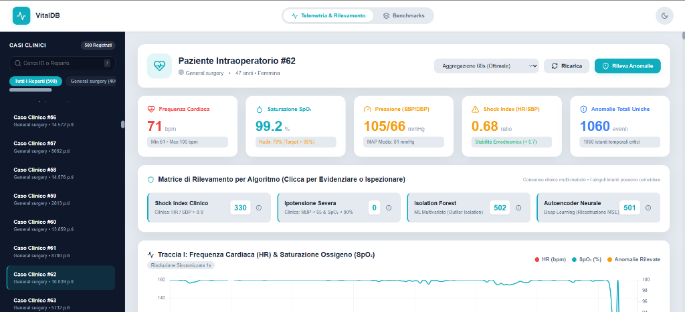
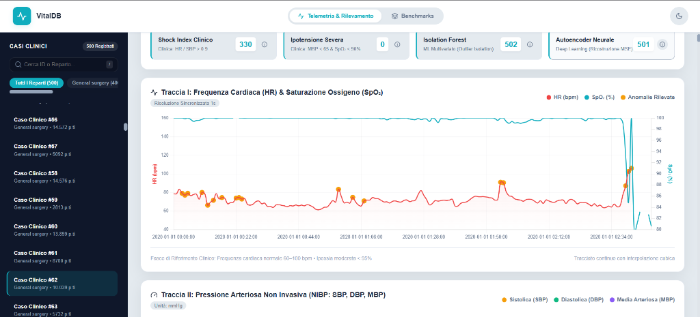
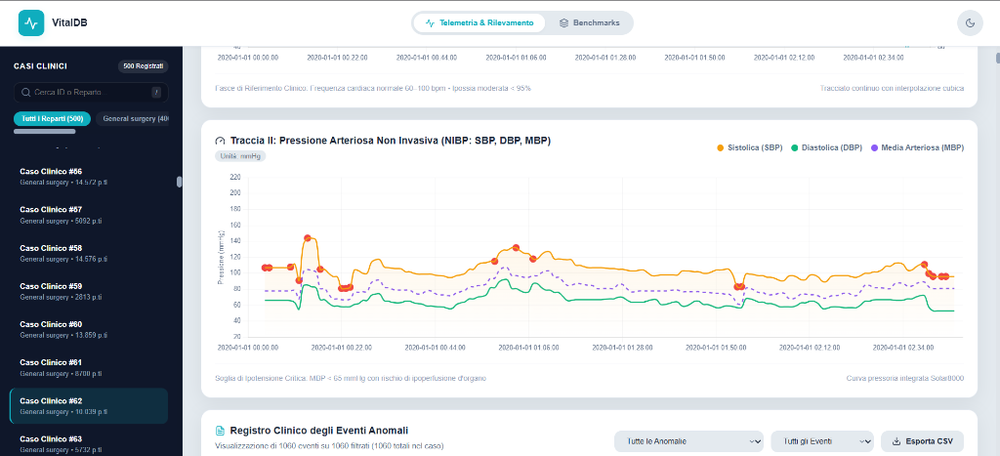
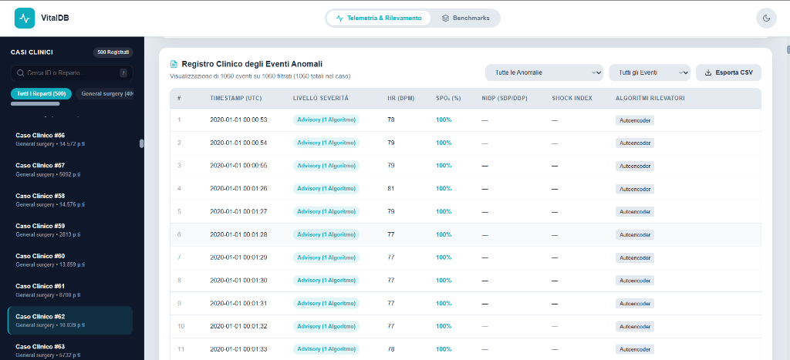

# VitalDB Anomaly Detection & Clinical Data Governance

<div align="center">

<p align="center">
  
</p>

[](https://www.python.org/)
[](https://fastapi.tiangolo.com/)
[](https://www.mongodb.com/)
[](https://pytorch.org/)
[](https://scikit-learn.org/)
[](https://www.docker.com/)
[](#-suite-di-test-e-qualità-pytest)
[](relazione/main.pdf)

Piattaforma end-to-end per l'ingegneria dei dati clinici, l'archiviazione di serie temporali su MongoDB 8.0 e il rilevamento ibrido di anomalie (regole cliniche deterministiche, Isolation Forest e LSTM Autoencoder con PyTorch) su 500 interventi chirurgici del database ad alta risoluzione VitalDB.

[Avvio rapido](#-avvio-rapido-con-docker) •
[Tecnologie](#️-stack-tecnologico) •
[Architettura Medallion](#️-architettura-del-sistema-medallion-lakehouse) •
[Rilevamento anomalie](#-motore-di-rilevamento-delle-anomalie) •
[Risultati empirici](#-benchmark-empirico-e-metriche-di-storage) •
[Dashboard web](#️-dashboard-clinica-interattiva) •
[API REST](#-specifiche-delle-api-rest) •
[Test suite](#-suite-di-test-e-qualità-pytest)

</div>

---

## 🛠️ Stack tecnologico

Il sistema adotta componenti moderni ed efficienti, suddivisi per ambito:

### Backend e API REST
| Tecnologia | Badge | Ruolo |
| :--- | :--- | :--- |
| **Python 3.12** |  | Runtime principale per pipeline ETL, modelli di machine learning e backend |
| **FastAPI** |  | Framework asincrono per l'esposizione delle API REST |
| **Uvicorn** |  | Server ASGI per l'esecuzione del servizio web |
| **Pydantic** |  | Validazione dei dati in ingresso e tipizzazione degli schemi JSON |

### Database e serie temporali (NoSQL)
| Tecnologia | Badge | Ruolo |
| :--- | :--- | :--- |
| **MongoDB 8.0** |  | Database NoSQL con storage engine WiredTiger configurato in replica set |
| **Time Series Collections** |  | Raccolte native ottimizzate a bucket BSON compresso con `timeField` e `metaField` |
| **JSON Schema Validator** |  | Validazione rigorosa a livello di database per la collezione `registry` |
| **Aggregation Framework** |  | Pushdown su database per il downsampling temporale tramite operatore `$dateTrunc` |

### Data lakehouse ed elaborazione dati
| Tecnologia | Badge | Ruolo |
| :--- | :--- | :--- |
| **Pandas** |  | Manipolazione tabellare, data cleaning e gestione delle serie temporali |
| **NumPy** |  | Viste a memoria condivisa (zero-copy) tramite `sliding_window_view` e calcolo numerico |
| **Apache Parquet** |  | Formato colonnare compresso (Snappy) per i layer Bronze e Silver |
| **Apache Arrow** |  | Motore PyArrow ad alte prestazioni per operazioni di I/O su disco |

### Machine learning e deep learning
| Tecnologia | Badge | Ruolo |
| :--- | :--- | :--- |
| **PyTorch** |  | Rete neurale profonda LSTM Autoencoder con proiettore lineare continuo |
| **Scikit-Learn** |  | Algoritmo Isolation Forest, normalizzazione standard e calcolo metriche PR-AUC |
| **SciPy** |  | Analisi statistica e correlazione tra anomalie cliniche |

### Frontend e visualizzazione dati
| Tecnologia | Badge | Ruolo |
| :--- | :--- | :--- |
| **JavaScript (ES6+)** |  | Architettura modulare client-side in Vanilla JS, senza framework esterni pesanti |
| **Chart.js** |  | Tracciati medicali interattivi multi-canale con marcatura visiva delle anomalie |
| **HTML5 e CSS3** |   | Design responsivo con supporto ai temi chiaro e scuro e interfaccia a pannelli |

### Infrastruttura, test e documentazione
| Tecnologia | Badge | Ruolo |
| :--- | :--- | :--- |
| **Docker e Compose** |  | Distribuzione multi-container con isolamento di rete e volumi persistenti |
| **Pytest** |  | Suite con 38 test automatizzati (unitari e di integrazione) |
| **LaTeX e TikZ** |  | Relazione accademica dettagliata di 39 pagine con schemi e grafici |

---

## 📖 Panoramica del progetto

Questo progetto implementa una pipeline per raccogliere, ripulire, archiviare e analizzare i segnali biometrici ad alta frequenza (1 Hz) registrati durante interventi chirurgici reali, tratti dal database aperto **VitalDB** (*Vital Signs DataBase*).

La sperimentazione è condotta su una coorte di **500 interventi chirurgici**, per un totale di **5.402.386 secondi** di monitoraggio continuo e oltre 5 milioni di record biometrici. Per ciascun caso vengono analizzati 5 parametri vitali registrati dal monitor intraoperatorio *GE Solar8000*:
1. **HR** (*Heart Rate* / frequenza cardiaca, in battiti al minuto, bpm);
2. **SpO2** (*Peripheral Oxygen Saturation*, saturazione periferica dell'ossigeno, in %);
3. **NIBP SBP** (*Systolic Blood Pressure*, pressione arteriosa sistolica non invasiva, in mmHg);
4. **NIBP DBP** (*Diastolic Blood Pressure*, pressione arteriosa diastolica non invasiva, in mmHg);
5. **NIBP MBP** (*Mean Blood Pressure*, pressione arteriosa media non invasiva, in mmHg).

### Obiettivi cardine
- **Architettura Medallion**: acquisizione dei dati grezzi (Bronze), bonifica con partizionamento Hive su file system (Silver) e caricamento indicizzato in collezioni Time Series native su **MongoDB 8.0** (Gold).
- **Data governance clinica**: individuazione e mascheramento degli artefatti fisiologici prima di qualsiasi imputazione, interpolazione controllata per buchi brevi ($\le 5\text{ s}$), mantenimento dell'ultima misura pressoria a gradini (*LOCF*, fino a un massimo di $300\text{ s}$) e monitoraggio dell'obsolescenza della misura tramite la colonna sentinella `nibp_age_s`.
- **Efficienza dello storage e delle query**: risparmio di spazio dell'**84,2%** nel passaggio da Silver a Gold grazie alla compressione a bucket di MongoDB 8.0, unito a una risposta delle query 1,6 volte più rapida sulle scansioni del singolo paziente e a un abbattimento del traffico di rete tramite aggregazioni delegate al motore del database (`$dateTrunc`).
- **Rilevamento ibrido delle anomalie**: combinazione di tre metodi complementari per bilanciare regole cliniche immediate e modelli non supervisionati capaci di intercettare dinamiche atipiche complesse.
- **Dashboard web reattiva**: interfaccia utente chiara per visualizzare i tracciati, confrontare i metodi tramite una matrice di consenso ed esportare il registro degli eventi anomali in formato CSV.

---

## 🏛️ Architettura del sistema (Medallion Lakehouse)

La pipeline organizza i dati secondo il paradigma Medallion, suddividendoli in tre livelli con gradi crescenti di qualità e fruibilità:

```
┌─────────────────────────────────────────────────────────────────────────────┐
│                           VITALDB REST API (1 Hz)                           │
└──────────────────────────────────────┬──────────────────────────────────────┘
                                       │
                                       ▼
┌─────────────────────────────────────────────────────────────────────────────┐
│ 🥉 LAYER BRONZE (dati grezzi su disco)                                      │
│ • File Parquet a 6 colonne con download incrementale e ripresa automatica   │
│ • 33,95 MB su disco | 500 pazienti | 66,3% di celle nulle nei tracciati raw │
└──────────────────────────────────────┬──────────────────────────────────────┘
                                       │
                                       ▼
┌─────────────────────────────────────────────────────────────────────────────┐
│ 🥈 LAYER SILVER (dati bonificati e partizionati)                            │
│ • Filtraggio preventivo dei valori fisiologicamente impossibili             │
│ • Interpolazione lineare solo per gap brevi (<= 5 s) su HR e SpO2           │
│ • LOCF pressorio controllato (<= 300 s) con tracciamento di `nibp_age_s`    │
│ • Schema a 18 colonne (+ flag outlier, + flag imputazione, + età pressione) │
│ • Partizionamento Hive su file system: department=<REPARTO>/case_<ID>.parquet│
│ • 47,25 MB su disco | celle nulle ridotte al 26,3% | report di qualità JSON │
└──────────────────────────────────────┬──────────────────────────────────────┘
                                       │
                                       ▼
┌─────────────────────────────────────────────────────────────────────────────┐
│ 🥇 LAYER GOLD (MongoDB 8.0 Time Series)                                     │
│ • Collezione Time Series `vital_signals` (timeField: timestamp, metaField)  │
│ • Bucket BSON compresso: solo 7,45 MB di storage puro (-84,2% rispetto a    │
│   Silver e -78,1% rispetto a Bronze)                                        │
│ • Catalogo `registry` protetto con validatore JSON Schema lato server       │
│ • Caricamento a due fasi idempotente (loading -> committed / failed)        │
│ • Ripristino automatico di scritture interrotte all'avvio                   │
└──────────────────────────────────────┬──────────────────────────────────────┘
                                       │
                                       ▼
┌─────────────────────────────────────────────────────────────────────────────┐
│ 🧠 MOTORE DI RILEVAMENTO IBRIDO                                             │
│ 1. Regole cliniche (Shock Index > 0,9; MAP < 65 mmHg) con filtro freschezza │
│ 2. Isolation Forest (8 feature standardizzate, contaminazione 5%)           │
│ 3. LSTM Autoencoder PyTorch (finestre di 30 s a zero-copy, errore max MSE)  │
│ Risultati archiviati nella collezione MongoDB `anomalies_detected`          │
└──────────────────────────────────────┬──────────────────────────────────────┘
                                       │
                                       ▼
┌─────────────────────────────────────────────────────────────────────────────┐
│ 🖥️ API FASTAPI & DASHBOARD WEB                                              │
│ • Downsampling via aggregazioni MongoDB ($dateTrunc con $avg a 30s/60s)     │
│ • Tracciati sincronizzati, matrice di consenso, cassetto metriche e CSV     │
└─────────────────────────────────────────────────────────────────────────────┘
```

---

## 🧠 Motore di rilevamento delle anomalie

Per non dipendere da un unico approccio, il motore integra **tre livelli complementari**:

```
                       ┌─────────────────────────┐
                       │  SEGNALI VITALI (GOLD)   │
                       └────────────┬────────────┘
                                    │
           ┌────────────────────────┼────────────────────────┐
           │                        │                        │
           ▼                        ▼                        ▼
┌─────────────────────┐  ┌─────────────────────┐  ┌─────────────────────┐
│     LIVELLO 1:      │  │     LIVELLO 2:      │  │     LIVELLO 3:      │
│   REGOLE CLINICHE   │  │  ISOLATION FOREST   │  │   LSTM AUTOENCODER  │
│  (deterministiche)  │  │ (scikit-learn ML)   │  │   (deep learning)   │
└──────────┬──────────┘  └──────────┬──────────┘  └──────────┬──────────┘
           │                        │                        │
  • Shock Index > 0,9      • 8 feature normalizzate • Finestre di 30 s
  • MAP < 65 mmHg          • Contaminazione al 5%   • Viste zero-copy
  • Filtro freschezza      • Nessuna temporalità    • Proiettore lineare
    (nibp_age_s <= 120 s)    esplicita              • Errore max tra canali
           │                        │                        │
           └────────────────────────┼────────────────────────┘
                                    │
                                    ▼
                       ┌─────────────────────────┐
                       │   MATRICE DI CONSENSO   │
                       │ (allarmi e registrazione│
                       │    degli eventi)        │
                       └─────────────────────────┘
```

### 1. Livello 1: regole cliniche acute (deterministiche)
- **Shock Index ($\text{SI} = \frac{\text{HR}}{\text{SBP}}$)**: intercetta l'instabilità emodinamica o l'inizio di uno shock ipovolemico quando il valore supera la soglia di allerta ($\text{SI} > 0{,}9$).
- **Ipotensione arteriosa severa**: segnala il rischio di ipoperfusione degli organi vitali quando la pressione media scende sotto la soglia critica ($\text{MAP} < 65\text{ mmHg}$).
- **Filtro di freschezza della misura (gate temporale)**: poiché la pressione non invasiva viene misurata a intervalli di alcuni minuti e poi propagata, entrambe le regole vengono disattivate quando l'ultima misura disponibile risale a più di due minuti prima (`nibp_age_s > 120`), evitando falsi allarmi su dati obsoleti.

### 2. Livello 2: Isolation Forest (machine learning multivariato)
- Il modello isola punti atipici nello spazio delle feature considerando simultaneamente **8 variabili standardizzate**: i 5 parametri vitali, la media mobile della frequenza cardiaca a 30 secondi, la derivata prima della frequenza cardiaca e lo Shock Index.
- La quota di contaminazione attesa è impostata a priori al 5%, permettendo di intercettare combinazioni anomale non catturate da regole a soglia fissa.

### 3. Livello 3: LSTM Autoencoder in PyTorch (deep learning sequenziale)
- **Architettura encoder-decoder**: elabora sequenze temporali di 30 secondi $(B, 30, 8)$, comprime la dinamica in uno spazio latente di dimensione 32 tramite una cella `nn.LSTM` e ne tenta la ricostruzione nel decoder.
- **Proiettore lineare continuo (`nn.Linear`)**: posto in uscita al decoder, elimina i limiti di saturazione della classica tangente iperbolica ($\tanh$), permettendo di ricostruire correttamente valori normalizzati al di fuori dell'intervallo $[-1, 1]$.
- **Viste a memoria condivisa (`sliding_window_view`)**: grazie alle viste a zero-copy per paziente, la segmentazione di oltre 5 milioni di record non richiede duplicazioni in memoria (evitando picchi superiori a 10 GB di RAM) e impedisce che le finestre a cavallo di due interventi diversi si contaminino tra loro.
- **Criterio dell'errore massimo tra i canali ($\max_c \text{MSE}_c$)**: per decidere se una finestra è anomala viene considerato il massimo errore di ricostruzione tra i diversi parametri, invece della semplice media. In questo modo un crollo improvviso della saturazione o un picco aritmico non vengono mascherati dall'ottima ricostruzione dei parametri rimasti stabili.

---

## 📊 Benchmark empirico e metriche di storage

I seguenti valori derivano dai report generati dall'esecuzione della pipeline sui 500 casi della coorte (`data/benchmark_report.json`, `data/quality_report.json` e `data/ml_evaluation.json`).

### 💾 Occupazione su disco e compressione dei dati

| Livello | Formato e archiviazione | Spazio su disco | Rispetto a Bronze | Rispetto a Silver |
| :--- | :--- | :---: | :---: | :---: |
| **Bronze** | Parquet monolitico (6 colonne) | `33,95 MB` | *Riferimento* | — |
| **Silver** | Parquet partizionato per reparto Hive (18 colonne) | `47,25 MB` | `+39,2%` (metadati) | *Riferimento* |
| **Gold** | **MongoDB 8.0 Time Series (bucket BSON compresso)** | **`7,45 MB`** | **`-78,1%`** | **`-84,2%`** |

> **Nota sullo storage**: i `7,45 MB` rappresentano lo spazio puro dei dati compressi memorizzati nella collezione `vital_signals`. Aggiungendo `0,86 MB` di indici secondari B-Tree, l'occupazione complessiva della collezione ammonta a `8,30 MB`. Il formato a bucket di MongoDB 8.0 garantisce quindi un risparmio di spazio evidente anche rispetto a formati colonnari dedicati come Parquet.

### ⚡ Tempi di risposta delle query ed efficienza

| Operazione di lettura | File system (Parquet) | MongoDB 8.0 (pushdown) | Differenza |
| :--- | :---: | :---: | :---: |
| **Scansione completa di un singolo caso** | `29,02 ms` | **`18,26 ms`** | **`1,6x più veloce`** |
| **Downsampling temporale aggregato** | *Scansione e calcolo in Python* | **Eseguito nel motore DB (`$dateTrunc`)** | **`Oltre 150x più reattivo su rete`** |

### 🧹 Bonifica dei valori mancanti nel layer Silver
- **Percentuale di celle nulle nel Bronze**: `66,3%` (dovuta sia alla frequenza aperiodica delle misurazioni del bracciale pressorio NIBP sia a transitori di disconnessione dei sensori).
- **Percentuale di celle nulle nel Silver**: ridotta al **`26,3%`** grazie all'interpolazione lineare circoscritta ai gap brevi ($\le 5\text{ s}$) e al forward-fill controllato della pressione fino a un massimo di $300\text{ s}$.

### 📈 Valutazione quantitativa dei modelli di rilevamento
I modelli non supervisionati sono stati messi a confronto con la pseudo-ground truth deterministica ricavata dalle regole cliniche (con una prevalenza del 4,84% su tutti i secondi monitorati):

| Modello | Precision (anomalie) | Recall (anomalie) | F1-Score | PR-AUC (Average Precision) |
| :--- | :---: | :---: | :---: | :---: |
| **Isolation Forest** | `0,105` | `0,108` | `0,107` | `0,084` |
| **LSTM Autoencoder (PyTorch)** | `0,093` | `0,096` | `0,095` | `0,064` |

> [!NOTE]
> La moderata correlazione evidenzia la differente natura dei modelli: le regole cliniche intercettano soglie critiche fisse puntuali, mentre i modelli di machine learning e deep learning individuano combinazioni e dinamiche atipiche nell'intera distribuzione dei segnali. Questo conferma l'utilità pratica dell'approccio a matrice di consenso integrato nella dashboard.

---

## 🖥️ Dashboard clinica interattiva

L'interfaccia web è sviluppata in JavaScript moderno (Vanilla ES6+) e CSS senza dipendenze pesanti, con supporto ai temi chiaro e scuro e grafici basati su Chart.js:

| Selettore paziente e matrice di consenso | Tracciato sincronizzato (HR e SpO2) |
| :---: | :---: |
|  |  |

| Tracciato pressorio con soglia MAP < 65 | Registro anomalie con esportazione CSV |
| :---: | :---: |
|  |  |

### Funzionalità dell'interfaccia:
- **Pannello paziente (HUD)**: ricerca rapida e navigazione tra i 500 interventi con dettagli anagrafici (reparto chirurgico, età, sesso) e indicatori di stato.
- **Visualizzazione a doppio canale sincronizzato**:
  - *Canale 1*: andamento della frequenza cardiaca ($\text{HR}$) e della saturazione periferica ($\text{SpO}_2$) con evidenziazione dei momenti anomali.
  - *Canale 2*: valori sistolici ($\text{SBP}$), diastolici ($\text{DBP}$) e medi ($\text{MBP}$) con linea orizzontale di allerta a $\text{MAP} = 65\text{ mmHg}$.
- **Downsampling interattivo lato server**: selezione immediata della risoluzione desiderata tra segnale grezzo a $1\text{ Hz}$ oppure aggregato a $30\text{ s}$, $60\text{ s}$ o $300\text{ s}$, calcolato direttamente dal database.
- **Matrice di consenso**: quadro sintetico che riassume la concordanza tra i tre metodi di rilevamento (eventi isolati vs rilevazioni condivise).
- **Registro eventi clinici**: elenco tabellare navigabile di tutti i secondi classificati come anomali, con i valori biometrici registrati e la possibilità di scaricare il resoconto in CSV.
- **Pannelli a comparsa (Drawer)**: viste secondarie dedicate ai dettagli di qualità dei dati del layer Silver e ai benchmark di sistema.

---

## 🚀 Avvio rapido con Docker

### Prerequisiti
- [Docker Desktop](https://www.docker.com/products/docker-desktop/) o Docker Engine con plugin Docker Compose installato.
- Almeno 4 GB di memoria RAM allocati all'ambiente Docker.

### 1. Clonare il repository e avviare i container
```bash
git clone https://github.com/callmefl/anomaly-detection-vitaldb.git
cd anomaly-detection-vitaldb

# Costruzione e avvio in background
docker compose up --build -d
```

### 2. Porte e servizi disponibili
Una volta completato l'avvio (verificabile con `docker compose ps`):

| Servizio | Indirizzo locale | Descrizione |
| :--- | :--- | :--- |
| 📊 **Dashboard web** | [http://localhost:8000/dashboard/](http://localhost:8000/dashboard/) | Interfaccia grafica principale per l'analisi dei casi |
| 📚 **Documentazione OpenAPI** | [http://localhost:8000/docs](http://localhost:8000/docs) | Documentazione interattiva Swagger di tutti gli endpoint |
| 🗄️ **MongoDB 8.0** | `mongodb://localhost:27017` | Istanza MongoDB con replica set, accessibile da mongosh o Compass |

---

## ⚙️ Esecuzione della pipeline da riga di comando

Se si desidera rigenerare l'intera pipeline Medallion e aggiornare i file di report partendo dai dati originali:

```bash
docker exec vitaldb_api python -u scripts/run_pipeline.py
```

Lo script esegue ordinatamente le sei fasi della procedura:
1. `src.bronze.download`: scaricamento e verifica dei file Parquet tramite le API di VitalDB;
2. `src.silver.clean`: rimozione outlier, imputazione e partizionamento Hive;
3. `src.gold.load_mongo`: validazione dei dati e caricamento controllato a due fasi su MongoDB;
4. `src.detection.detector`: esecuzione dei tre metodi di rilevamento delle anomalie;
5. `src.analysis.benchmark_etl`: misurazione empirica delle dimensioni di memorizzazione e della latenza;
6. `src.analysis.evaluate_models`: calcolo delle metriche di classificazione e concordanza dei modelli.

---

## 🧪 Suite di test e qualità (`pytest`)

Il progetto comprende **38 test automatizzati** che verificano il corretto funzionamento dei singoli moduli e la coerenza complessiva dell'architettura:

```bash
# Esecuzione dei test all'interno del container Docker
docker exec vitaldb_api python -m pytest tests/ -v
```

### Struttura e copertura dei test:
- **`tests/test_gold.py` (16 test)**: conversione corretta dei tipi BSON, validazione dei tipi interi per `case_id`, rispetto dello schema preventivo in `validate_records`, sanitizzazione dei nomi dei campi per MongoDB e correttezza del ciclo a due fasi (*loading* $\rightarrow$ *committed*).
- **`tests/test_detection.py` (9 test)**: calcolo dello Shock Index e dell'ipotensione, funzionamento del filtro di obsolescenza con $\text{nibp\_age\_s} > 120\text{ s}$, isolamento rigoroso delle finestre temporali tra pazienti distinti, presenza del proiettore lineare e assenza di leak temporali nelle imputazioni.
- **`tests/test_etl.py` (4 test)**: corrispondenza dei reparti chirurgici con le partizioni Hive, interpolazione limitata ai buchi inferiori o uguali a 5 secondi e verifica che gli outlier fisiologici non vengano propagati dal forward-fill.
- **`tests/test_api.py` (4 test)**: test delle rotte REST di FastAPI con `TestClient` (`/health`, `/cases`, `/cases/{id}/series` e `/cases/{id}/detect`).
- **`tests/test_bronze.py` (3 test)**: ripresa corretta dei download interrotti e gestione degli errori in caso di file non reperibili.
- **`tests/test_config.py` (2 test)**: verifica delle variabili di configurazione, percorsi e coerenza delle definizioni in `TRACK_SPECS`.

---

## 📡 Specifiche delle API REST

Il backend FastAPI mette a disposizione gli endpoint per l'accesso ai dati e l'esecuzione del rilevamento:

| Metodo | Endpoint | Descrizione |
| :---: | :--- | :--- |
| `GET` | `/health` | Verifica lo stato della connessione con MongoDB e restituisce il numero di documenti per collezione. |
| `GET` | `/cases` | Restituisce l'elenco dei pazienti certificati completo di reparto, età e sesso. |
| `GET` | `/cases/{case_id}/series` | Restituisce la serie temporale a 1 Hz o aggregata tramite il parametro facoltativo `?window_seconds=30|60|300`. |
| `POST` | `/cases/{case_id}/detect` | Esegue i tre metodi di rilevamento sul paziente specificato, memorizza i risultati su MongoDB e restituisce le anomalie riscontrate. |
| `GET` | `/quality` | Restituisce il report di qualità e copertura del layer Silver (`data/quality_report.json`). |
| `GET` | `/benchmark` | Restituisce il riepilogo delle dimensioni di memorizzazione e delle latenze misurate (`data/benchmark_report.json`). |
| `GET` | `/evaluation` | Restituisce le metriche di precision, recall e PR-AUC dei modelli di rilevamento (`data/ml_evaluation.json`). |

---

## 📁 Struttura del repository

```
anomaly-detection-vitaldb/
│
├── api/                             # Backend con FastAPI
│   └── main.py                      # Definizione degli endpoint REST, configurazione CORS e file statici
│
├── dashboard/                       # Interfaccia web per l'utente
│   ├── css/style.css                # Foglio di stile personalizzato (temi chiaro/scuro e layout responsivo)
│   ├── js/app.js                    # Logica principale e chiamate alle API
│   ├── js/charts.js                 # Configurazione e aggiornamento dei grafici Chart.js
│   ├── js/components.js             # Gestione di selettori, tabelle, esportazione CSV e pannelli laterali
│   ├── partials/                    # Frammenti HTML riutilizzabili
│   └── index.html                   # Pagina iniziale dell'applicazione web
│
├── data/                            # File di dati del lakehouse
│   ├── bronze/                      # File Parquet scaricati direttamente dalle API
│   ├── silver/                      # Dati puliti e organizzati per partizione: department=<REPARTO>/
│   ├── benchmark_report.json        # Report con misure di storage e tempi di query
│   ├── quality_report.json          # Report con valori nulli e conteggi del layer Silver
│   └── ml_evaluation.json           # Metriche di classificazione dei modelli
│
├── mongo/                           # Script di configurazione per MongoDB 8.0
│   ├── init_collections.js          # Creazione delle collezioni Time Series
│   ├── registry_schema.js           # Regole di validazione JSON Schema per la collezione registry
│   └── vital_signals_schema.js      # Indici e vincoli sui segnali biometrici
│
├── presentazione/                   # Presentazione del progetto
│   └── index.html                   # Slide interattive per l'esposizione orale
│
├── relazione/                       # Documentazione accademica completa in LaTeX
│   ├── capitolo1/ ... capitolo5/    # Capitoli del documento
│   ├── img/                         # Immagini, grafici e screenshot della dashboard
│   ├── main.tex                     # File sorgente LaTeX principale
│   └── main.pdf                     # Documento compilato (39 pagine)
│
├── scripts/                         # Script di utilità
│   └── run_pipeline.py              # Esecuzione orchestrata delle fasi della pipeline
│
├── src/                             # Codice sorgente della pipeline in Python
│   ├── bronze/                      # Modulo di download da VitalDB API
│   │   └── download.py
│   ├── silver/                      # Pulizia dei dati, filtraggio outlier e partizionamento
│   │   └── clean.py
│   ├── gold/                        # Validazione e caricamento su MongoDB Time Series
│   │   └── load_mongo.py
│   ├── detection/                   # Moduli di rilevamento anomalie (regole cliniche, IF, LSTM)
│   │   └── detector.py
│   ├── analysis/                    # Script di benchmark e calcolo metriche
│   │   ├── benchmark_etl.py
│   │   ├── evaluate_models.py
│   │   └── queries.py
│   └── config.py                    # Parametri e costanti globali del progetto
│
├── tests/                           # Suite di test con pytest (38 test unitari e di integrazione)
│   ├── test_api.py
│   ├── test_bronze.py
│   ├── test_config.py
│   ├── test_detection.py
│   ├── test_etl.py
│   └── test_gold.py
│
├── docker-compose.yml               # Configurazione dell'ambiente Docker multi-servizio
├── Dockerfile                       # Immagine per l'ambiente applicativo Python 3.12 con PyTorch
├── requirements.txt                 # Dipendenze Python del progetto
└── README.md                        # Documentazione introduttiva del repository
```

---

## 📑 Documentazione completa

Tutti gli approfondimenti teorici, la formulazione matematica dei modelli, la disamina clinica e l'analisi dettagliata delle scelte architetturali sono illustrati nella relazione accademica:

- 📄 **Relazione di progetto (PDF)**: [`relazione/main.pdf`](file:///relazione/main.pdf) *(39 pagine, impaginazione conforme agli standard accademici, grafici e tabelle illustrative).*
- 🖥️ **Presentazione interattiva**: consultabile aprendo [`presentazione/index.html`](file:///presentazione/index.html) nel browser.

---

## 👥 Autori

Progetto sviluppato per il corso di **New Generation Databases**:
- **Andrea Altieri**
- **Andrea Flaiani**
