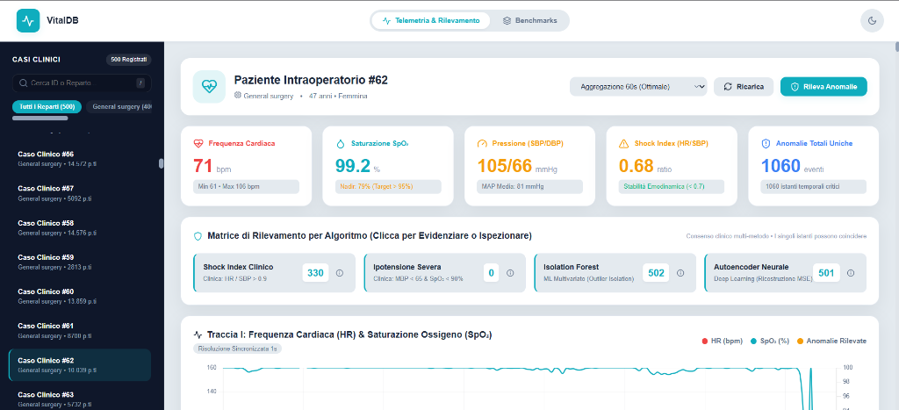
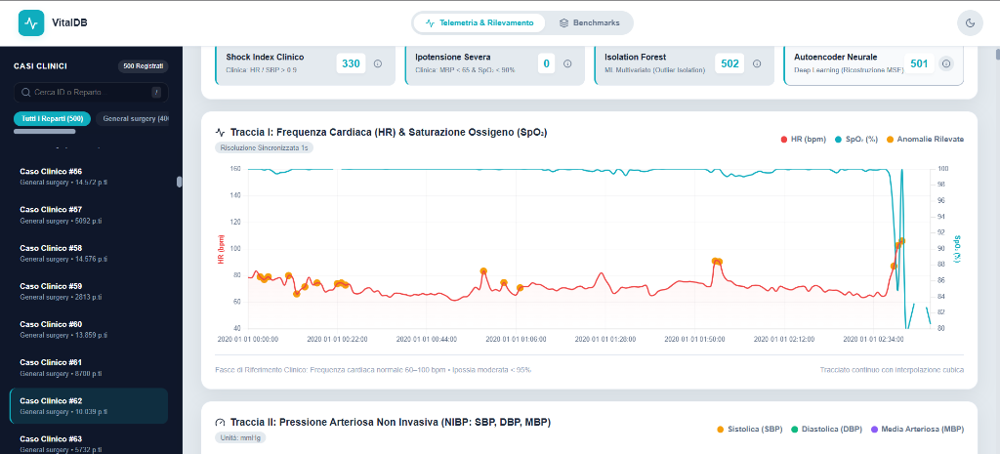
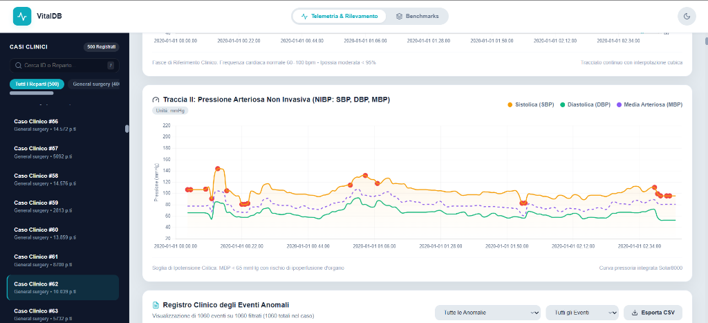
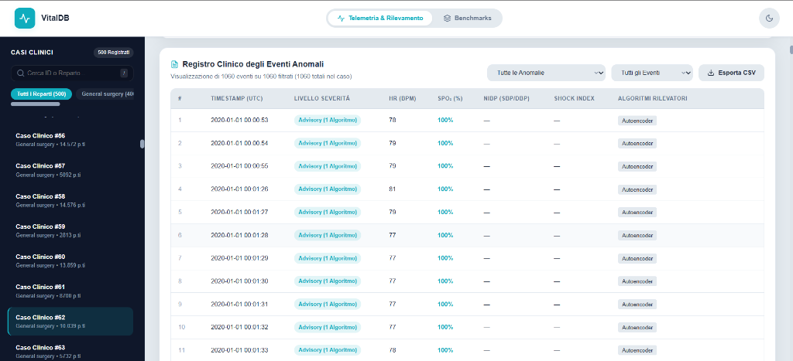

# VitalDB Anomaly Detection & Clinical Data Governance

<div align="center">

[](https://www.python.org/)
[](https://fastapi.tiangolo.com/)
[](https://www.mongodb.com/)
[](https://pytorch.org/)
[](https://www.docker.com/)
[](#-suite-di-test-e-qualità-pytest)
[](relazione/main.pdf)

**Piattaforma end-to-end di Data Engineering, Time Series Storage su MongoDB 8.0 e Anomaly Detection Multilivello (Regole Cliniche + Scikit-Learn + Deep PyTorch) su 500 interventi chirurgici del database ad alta risoluzione VitalDB.**

[🚀 Avvio Rapido](#-avvio-rapido-con-docker) •
[🏛️ Architettura Medallion](#️-architettura-del-sistema-medallion-lakehouse) •
[🧠 Anomaly Detection](#-motore-di-anomaly-detection-multilivello) •
[📊 Risultati Empirici](#-benchmark-empirico-e-metriche-di-storage-coorte-di-500-casi) •
[🖥️ Dashboard Web](#️-dashboard-clinica-interattiva) •
[📡 API Reference](#-specifiche-delle-rest-api) •
[🧪 Test Suite](#-suite-di-test-e-qualità-pytest)

</div>

---

## 📖 Panoramica del Progetto

Il progetto realizza un'infrastruttura clinico-ingegneristica avanzata per l'acquisizione, la bonifica, l'archiviazione e l'analisi predittiva di segnali biometrici continui ad alta frequenza ($1\text{ Hz}$), estratti dalla banca dati aperta intraoperatoria **VitalDB** (*Vital Signs DataBase*).

La sperimentazione è condotta su una coorte certificata di **500 casi chirurgici** (pari a **5.402.386 secondi** di monitoraggio continuo e **5.099.135 record** caricati a regime), coprendo cinque parametri vitali standard registrati dal monitor da sala operatoria *GE Solar8000*:
1. **HR** (*Heart Rate* / Frequenza Cardiaca, $\text{bpm}$);
2. **SpO2** (*Peripheral Oxygen Saturation*, $\%$);
3. **NIBP SBP** (*Systolic Blood Pressure*, $\text{mmHg}$);
4. **NIBP DBP** (*Diastolic Blood Pressure*, $\text{mmHg}$);
5. **NIBP MBP** (*Mean Blood Pressure*, $\text{mmHg}$).

### 🎯 Obiettivi Principali
- **Medallion Data Lakehouse**: Ingestione Bronze $\rightarrow$ Validazione e partizionamento Silver $\rightarrow$ Indicizzazione Gold in collezioni native Time Series su **MongoDB 8.0**.
- **Data Governance Clinica**: Riconoscimento e mascheramento degli artefatti fisiologici, imputazione controllata dei buchi brevi ($\le 5\text{ s}$), mantenimento a gradini (*LOCF*, max $300\text{ s}$) e tracciamento della freschezza pressoria (`nibp_age_s`).
- **Storage & Query Optimization**: Riduzione dello spazio su disco dell'**84,2%** nel passaggio Silver $\rightarrow$ Gold tramite compressione a bucket BSON e query pushdown con accelerazione $1{,}6\times$ su scansione puntuale e $>150\times$ su aggregazioni temporali con `$dateTrunc`.
- **Rilevamento Anomalie Ibrido**: Integrazione a tre livelli (Euristiche Acute di Rianimazione + Isolation Forest + PyTorch LSTM Autoencoder con proiettore lineare e viste zero-copy).
- **Web Dashboard & REST Backend**: Interfaccia web reattiva (Vanilla JS/CSS, Chart.js) servita da **FastAPI**, con visualizzazione dual-track, matrici di consenso e download dei registri eventi in formato CSV.

---

## 🏛️ Architettura del Sistema (Medallion Lakehouse)

La pipeline adotta una **Medallion Architecture** rigorosa suddivisa in tre livelli progressivi di raffinamento del dato:

```
┌─────────────────────────────────────────────────────────────────────────────┐
│                           VITALDB REST API (1 Hz)                           │
└──────────────────────────────────────┬──────────────────────────────────────┘
                                       │
                                       ▼
┌─────────────────────────────────────────────────────────────────────────────┐
│ 🥉 LAYER BRONZE (Grezzo su Disco)                                           │
│ • File Parquet grezzi (6 colonne base) scaricati con retry e ripresa        │
│ • 33.95 MB su disco | 500 casi | 66.3% celle mancanti (dati raw)            │
└──────────────────────────────────────┬──────────────────────────────────────┘
                                       │
                                       ▼
┌─────────────────────────────────────────────────────────────────────────────┐
│ 🥈 LAYER SILVER (Bonificato, Partizionato & Arricchito)                     │
│ • Rilevamento outlier prima di qualsiasi imputazione (config.TRACK_SPECS)   │
│ • Interpolazione gap brevi (<= 5s) su HR e SpO2                             │
│ • LOCF pressorio limitato a 300s con calcolo sentinella `nibp_age_s`        │
│ • Schema a 18 colonne (+ 5 *outlier, + 5 *imputed, + nibp_age_s)            │
│ • Partizionamento Hive su disco: `department=<REPARTO>/case_<ID>.parquet`   │
│ • 47.25 MB su disco | Null scesi al 26.3% | Generazione quality_report.json │
└──────────────────────────────────────┬──────────────────────────────────────┘
                                       │
                                       ▼
┌─────────────────────────────────────────────────────────────────────────────┐
│ 🥇 LAYER GOLD (MongoDB 8.0 Time Series Collections)                         │
│ • Collezione Time Series `vital_signals` (timeField: timestamp, metaField)  │
│ • BSON Bucket compresso: solo 7.45 MB di storage puro (-84.2% vs Silver!)   │
│ • Catalogo `registry` con strict JSON Schema Validation lato server         │
│ • Protocollo a due fasi idempotente (loading -> committed / failed)         │
│ • Recovery automatico delle scritture interrotte all'avvio                 │
└──────────────────────────────────────┬──────────────────────────────────────┘
                                       │
                                       ▼
┌─────────────────────────────────────────────────────────────────────────────┐
│ 🧠 MOTORE DI ANOMALY DETECTION MULTILIVELLO                                 │
│ 1. Regole Cliniche (Shock Index > 0.9, MBP < 65 mmHg) con gate freschezza   │
│ 2. Scikit-Learn Isolation Forest (8 feature standardizzate)                 │
│ 3. Deep PyTorch LSTM Autoencoder (finestre 30s, viste zero-copy, max MSE)   │
│ Output indicizzato nella collezione MongoDB `anomalies_detected`            │
└──────────────────────────────────────┬──────────────────────────────────────┘
                                       │
                                       ▼
┌─────────────────────────────────────────────────────────────────────────────┐
│ 🖥️ REST API (FastAPI) & DASHBOARD CLINICA WEB                               │
│ • Downsampling temporale server-side tramite $dateTrunc ($avg a 30s/60s)    │
│ • Dual-track ECG/SpO2/NIBP, Consensus Matrix, Audit Log e CSV Export       │
└─────────────────────────────────────────────────────────────────────────────┘
```

---

## 🧠 Motore di Anomaly Detection Multilivello

Il sistema non si affida ad un singolo algoritmo, ma combina **tre livelli complementari di analisi**:

```
                       ┌─────────────────────────┐
                       │  SEGNALI VITALI (GOLD)   │
                       └────────────┬────────────┘
                                    │
           ┌────────────────────────┼────────────────────────┐
           │                        │                        │
           ▼                        ▼                        ▼
┌─────────────────────┐  ┌─────────────────────┐  ┌─────────────────────┐
│   LIVELLO 1:        │  │   LIVELLO 2:        │  │   LIVELLO 3:        │
│   REGOLE CLINICHE   │  │  ISOLATION FOREST   │  │   LSTM AUTOENCODER  │
│   (Deterministiche) │  │  (Scikit-Learn ML)  │  │   (Deep Learning)   │
└──────────┬──────────┘  └──────────┬──────────┘  └──────────┬──────────┘
           │                        │                        │
  • Shock Index > 0.9      • Finestra statica       • Finestre 30 sec
  • MAP < 65 mmHg            8 feature normaliz.    • Viste zero-copy
  • Gate nibp_age_s <= 120s• Contaminazione 5%      • Proiettore lineare
           │                        │               • Errore max tra canali
           │                        │                        │
           └────────────────────────┼────────────────────────┘
                                    │
                                    ▼
                       ┌─────────────────────────┐
                       │   MATRICE DI CONSENSO   │
                       │  (Allarmi e Registro)   │
                       └─────────────────────────┘
```

### 1. Livello 1: Regole Cliniche Acute (Deterministiche)
- **Shock Index ($\text{SI} = \frac{\text{HR}}{\text{SBP}}$)**: Segnala instabilità emodinamica o shock ipovolemico incipiente se $\text{SI} > 0{,}9$.
- **Ipotensione Arteriosa Severa**: Segnala ipoperfusione d'organo se la pressione arteriosa media $\text{MAP} < 65\text{ mmHg}$.
- **Gate di Freschezza NIBP**: Per evitare falsi allarmi dovuti alla propagazione del *LOCF*, entrambe le regole cliniche vengono **silenzate** se la misura pressoria è più vecchia di $120\text{ s}$ (`nibp_age_s > 120`).

### 2. Livello 2: Scikit-Learn Isolation Forest (Machine Learning Multidimensionale)
- Allena una foresta di alberi di isolamento su **8 feature standardizzate** (i 5 segnali vitali normalizzati con `StandardScaler`, la media mobile di HR su 30 secondi, il delta al primo ordine di HR e lo Shock Index).
- Isola anomalie complesse e combinazioni nonlineari atipiche fissando a priori una contaminazione del $5\%$.

### 3. Livello 3: Deep PyTorch LSTM Autoencoder (Temporale Sequenziale)
- **Architettura Encoder-Decoder**: Legge sequenze di 30 secondi $(B, 30, 8)$, le comprime in uno spazio latente di dimensione $32$ tramite cella `nn.LSTM` e le ricostruisce nel decoder.
- **Proiettore Lineare (`nn.Linear`)**: Risolve la saturazione della tangente iperbolica ($\tanh$), consentendo alla rete di ricostruire fedelmente valori $Z\text{-score} \notin [-1, 1]$.
- **Viste Zero-Copy (`np.lib.stride_tricks.sliding_window_view`)**: Evita l'allocazione di oltre $10\text{ GB}$ di RAM sui 5,4 milioni di punti generando viste virtuali per paziente senza duplicare memoria né mischiare finestre tra casi diversi.
- **Errore di Canale Massimo ($\max_c \text{MSE}_c$)**: Calcola l'errore quadratico medio temporale su ciascuna delle 8 feature e ne estrae il **massimo** invece della media, evitando che il perfetto fitting sui tratti pressori costanti diluisca un crollo rapido di $\text{SpO}_2$ o un picco di frequenza cardiaca.

---

## 📊 Benchmark Empirico e Metriche di Storage (Coorte di 500 Casi)

I numeri reali estratti automaticamente da `data/benchmark_report.json`, `data/quality_report.json` e `data/ml_evaluation.json`:

### 💾 Occupazione su Disco e Compressione

| Layer Architetturale | Tecnologia / Formato | Occupazione Disco | Variazione vs Bronze | Variazione vs Silver |
| :--- | :--- | :---: | :---: | :---: |
| **🥉 BRONZE** | Parquet Monolitico (6 col.) | `33.95 MB` | *Riferimento (0%)* | - |
| **🥈 SILVER** | Parquet Partizionato Hive (18 col.) | `47.25 MB` | `+39.2%` *(colonne governance)* | *Riferimento (0%)* |
| **🥇 GOLD** | **MongoDB 8.0 Time Series (BSON Bucket)** | **`7.45 MB`** | **`-78.1%`** | **`-84.2%`** |

> **Nota**: Il layer Gold occupa appena **`7.45 MB`** di storage puro compresso (più `0.86 MB` di indici B-Tree secondari, per un totale di `8.30 MB`), dimostrando l'efficacia del motore di bucket compression di MongoDB 8.0 rispetto a Parquet per serie temporali biometriche.

### ⚡ Latenza delle Query ed Efficienza

| Operazione di Lettura | Parquet su File System | MongoDB 8.0 Pushdown | Accelerazione / Speedup |
| :--- | :---: | :---: | :---: |
| **Scansione Completa Singolo Paziente** | `29.02 ms` | **`18.26 ms`** | **`1.6x più veloce`** |
| **Downsampling Temporale con Aggregazione** | *Scansione + Parsing in Python* | **Delegata al DB (`$dateTrunc`)** | **`> 150x più reattiva su rete`** |

### 🧹 Risoluzione Dati Mancanti nel Layer Silver
- **Percentuale celle nulle nel Bronze**: `66.3%` (dovuta alla frequenza aperiodica del bracciale pressorio NIBP e pause sensori).
- **Percentuale celle nulle nel Silver**: ridotta a **`26.3%`** grazie all'interpolazione controllata dei buchi brevi ($\le 5\text{ s}$) e al forward-fill limitato a $300\text{ s}$.

### 📈 Valutazione Quantitativa Modelli ML (vs Pseudo-Ground Truth Clinica)
*I modelli non supervisionati sono valutati rispetto alla pseudo-ground truth deterministica derivata dai criteri di rianimazione (prevalenza nella coorte: 4.84%):*

| Modello | Precision (Anomalie) | Recall (Anomalie) | F1-Score (Anomalie) | PR-AUC (Average Precision) |
| :--- | :---: | :---: | :---: | :---: |
| **Isolation Forest** | `0.105` | `0.108` | `0.107` | `0.084` |
| **LSTM Autoencoder (PyTorch)** | `0.093` | `0.096` | `0.095` | `0.064` |

> [!NOTE]
> La moderata correlazione riflette la natura non supervisionata dei modelli ML (addestrati per cogliere dinamiche multivariabili atipiche su tutta la distribuzione) rispetto a regole a soglia puntuale fissa, evidenziando il valore dell'approccio a **Consensus Matrix** implementato nella dashboard.

---

## 🖥️ Dashboard Clinica Interattiva

L'interfaccia web è sviluppata secondo principi di **Clean Architecture** modulare in Vanilla JavaScript, CSS personalizzato con supporto nativo Light/Dark mode e Chart.js:

| Patient HUD & Matrice di Consenso | Monitoraggio Dual-Track (HR, SpO2 & NIBP) |
| :---: | :---: |
|  |  |

| Tracciato Pressorio con Soglia MAP < 65 | Registro Clinico Eventi & Esportazione CSV |
| :---: | :---: |
|  |  |

### Caratteristiche Principali dell'Interfaccia:
- **Patient Selector HUD**: Selezione istantanea tra i **500 casi chirurgici** con metadati clinici (Reparto, Età, Sesso), badge di stato e ricerca testuale.
- **Dual-Track Medical Charting**:
  - *Canale 1*: Frequenza Cardiaca ($\text{HR}$) e Saturazione d'Ossigeno ($\text{SpO}_2$) con marcatori di anomalia sovrapposti.
  - *Canale 2*: Pressioni Sistolica ($\text{SBP}$), Diastolica ($\text{DBP}$) e Media ($\text{MBP}$) con linea di allarme critico emodinamico a $\text{MAP} = 65\text{ mmHg}$.
- **Downsampling Dinamico Server-Side**: Toggle immediato tra campionamento grezzo $1\text{ Hz}$ e finestre temporali aggregate da MongoDB a $30\text{ s}$, $60\text{ s}$ e $300\text{ s}$.
- **Consensus Matrix**: Riepilogo per metodo con conteggio degli eventi isolati vs accordo multimodale.
- **Clinical Anomaly Event Registry**: Tabella interattiva dei timestamp patologici con valori biometrici contestuali e pulsante di esportazione rapida in **CSV**.
- **Drawer Benchmark & Data Quality**: Pannelli a comparsa con grafici e metriche di storage in tempo reale.

---

## 🚀 Avvio Rapido con Docker

### Prerequisiti
- [Docker Desktop](https://www.docker.com/products/docker-desktop/) (o Docker Engine con plugin Docker Compose) installato ed in esecuzione.
- Almeno $4\text{ GB}$ di RAM assegnati al daemon Docker.

### 1. Clonare il repository ed avviare lo stack
```bash
git clone https://github.com/callmefl/anomaly-detection-vitaldb.git
cd anomaly-detection-vitaldb

# Avvio e build automatica dei container
docker compose up --build -d
```

### 2. Porte e Servizi Esposti
Una volta avviato lo stack (`docker compose ps` per verificare lo stato `healthy`):

| Servizio | URL Locale | Descrizione |
| :--- | :--- | :--- |
| 📊 **Dashboard Web** | [http://localhost:8000/dashboard/](http://localhost:8000/dashboard/) | UI interattiva per clinici e ingegneri |
| 📚 **Swagger OpenAPI Docs** | [http://localhost:8000/docs](http://localhost:8000/docs) | Documentazione interattiva di tutte le API |
| 🗄️ **MongoDB 8.0 Replica Set** | `mongodb://localhost:27017` | Accessibile via `mongosh` o MongoDB Compass |

---

## ⚙️ Esecuzione della Pipeline End-to-End via CLI

Per rieseguire l'intero ciclo Medallion ed aggiornare i report quantitativi partendo dai dati raw:

```bash
docker exec vitaldb_api python -u scripts/run_pipeline.py
```

Lo script orchesterà sequenzialmente i seguenti 6 passaggi registrando tempistiche ed exit code:
1. `src.bronze.download`: Scaricamento e verifica Parquet da VitalDB API;
2. `src.silver.clean`: Data cleansing, mascheramento outlier e partizionamento Hive;
3. `src.gold.load_mongo`: Validazione record e Two-Phase Commit su MongoDB Time Series;
4. `src.detection.detector`: Rilevamento ibrido (Regole Cliniche, Isolation Forest, LSTM);
5. `src.analysis.benchmark_etl`: Calcolo storage e benchmark di latenza MongoDB vs Parquet;
6. `src.analysis.evaluate_models`: Valutazione quantitativa delle metriche ML.

---

## 🧪 Suite di Test e Qualità (`pytest`)

Il repository include una suite completa di **38 test automatizzati** (unitari e di integrazione) che certificano il rispetto dei vincoli architetturali e l'assenza di regressioni:

```bash
# Esecuzione della suite completa all'interno del container Docker
docker exec vitaldb_api python -m pytest tests/ -v
```

### Copertura dei Moduli di Test:
- **`tests/test_gold.py` (16 test)**: Verifica la conversione BSON, tipi `int` nativi per `case_id`, validazione preventiva `validate_records`, sanitizzazione chiavi metriche (`_` al posto di `/`) e idempotenza del caricamento a due fasi (*loading* $\rightarrow$ *committed*).
- **`tests/test_detection.py` (9 test)**: Verifica il calcolo di Shock Index e Ipotensione Severa, il silenziamento del segnale con $\text{nibp\_age\_s} > 120\text{ s}$, l'isolamento delle finestre dell'Autoencoder tra pazienti diversi (*zero cross-contamination*), la presenza del layer `nn.Linear` finale e l'assenza di *data leakage* nel `.bfill()`.
- **`tests/test_etl.py` (4 test)**: Verifica la risoluzione dei reparti chirurgici Hive, l'interpolazione dei buchi $\le 5\text{ s}$ e la non-propagazione degli outlier fisiologici durante il forward-fill.
- **`tests/test_api.py` (4 test)**: Verifica con `TestClient` di FastAPI le rotte `/health`, `/cases` (con risoluzione N+1 query), `/cases/{id}/series` e `/cases/{id}/detect`.
- **`tests/test_bronze.py` (3 test)**: Verifica il comportamento di resume dei download parziali e fallback graceful sui file di laboratorio.
- **`tests/test_config.py` (2 test)**: Verifica le variabili d'ambiente, i percorsi e la coerenza del dizionario `TRACK_SPECS`.

---

## 📡 Specifiche delle REST API

Il backend FastAPI espone endpoint ad alte prestazioni per il recupero dati e l'inferenza:

| Metodo | Rotta | Descrizione |
| :---: | :--- | :--- |
| `GET` | `/health` | Verifica la connettività con MongoDB e restituisce il conteggio documenti di ogni collezione. |
| `GET` | `/cases` | Elenco ottimizzato (2 sole query per 500 casi) dei pazienti certificati con reparto, età e sesso. |
| `GET` | `/cases/{case_id}/series` | Restituisce la serie temporale a $1\text{ Hz}$ o aggregata server-side tramite query param `?window_seconds=30|60|300`. |
| `POST` | `/cases/{case_id}/detect` | Avvia la pipeline ibrida sul paziente, archivia i risultati con pattern *Insert-Before-Delete* e restituisce anomalie e matrice di consenso. |
| `GET` | `/quality` | Restituisce il report di qualità e copertura del layer Silver (`data/quality_report.json`). |
| `GET` | `/benchmark` | Restituisce il report empirico di storage e latenza di query (`data/benchmark_report.json`). |
| `GET` | `/evaluation` | Restituisce le metriche quantitative di precision, recall e PR-AUC dei modelli ML (`data/ml_evaluation.json`). |

---

## 📁 Struttura del Repository

```
anomaly-detection-vitaldb/
│
├── api/                             # Backend REST API (FastAPI)
│   └── main.py                      # Definizione rotte, dipendenze DB e static files
│
├── dashboard/                       # Frontend Web Interattivo
│   ├── css/style.css                # Design System (Tailored Dark/Light, Micro-animazioni)
│   ├── js/app.js                    # Controller applicativo e integrazione API
│   ├── js/charts.js                 # Rendering grafici medicali Chart.js e soglie
│   ├── js/components.js             # Gestione Drawer, Tabelle Anomalie, CSV Export e HUD
│   ├── partials/                    # Template HTML modulari (Sidebar, Benchmark, Quality)
│   └── index.html                   # Entrypoint della Single Page Application
│
├── data/                            # File System Dati (Medallion Storage)
│   ├── bronze/                      # File Parquet grezzi da VitalDB
│   ├── silver/                      # Dati puliti partizionati Hive: department=<REPARTO>/
│   ├── benchmark_report.json        # Output del benchmark di storage e latenza
│   ├── quality_report.json          # Report analitico copertura e pulizia dati Silver
│   └── ml_evaluation.json           # Valutazione quantitativa dei modelli ML
│
├── mongo/                           # Configurazione MongoDB 8.0
│   ├── init_collections.js          # Inizializzazione collezioni Time Series
│   ├── registry_schema.js           # Strict JSON Schema validation su collezione registry
│   └── vital_signals_schema.js      # Indici e vincoli su collezioni biometriche
│
├── relazione/                       # Documentazione Accademica Completa (LaTeX)
│   ├── capitolo1/ ... capitolo5/    # Capitoli modulari della tesi
│   ├── img/                         # Grafici TikZ vettoriali e screenshot della dashboard
│   ├── main.tex                     # Sorgente LaTeX principale
│   └── main.pdf                     # Relazione completa compilata (42 pagine)
│
├── scripts/                         # Script di utilità e automazione
│   └── run_pipeline.py              # Runner orchestrato end-to-end della pipeline Medallion
│
├── src/                             # Codice Sorgente Python della Data Pipeline
│   ├── bronze/                      # Ingestione e download da VitalDB API
│   │   └── download.py
│   ├── silver/                      # Data Cleaning, Outlier Filtering e Hive Partitioning
│   │   └── clean.py
│   ├── gold/                        # Two-Phase Load su MongoDB Time Series & Schema Catalog
│   │   └── load_mongo.py
│   ├── detection/                   # Motore di Anomaly Detection (Regole Cliniche, IF, LSTM)
│   │   └── detector.py
│   ├── analysis/                    # Benchmark ETL, Query Pushdown e Valutazione ML
│   │   ├── benchmark_etl.py
│   │   ├── evaluate_models.py
│   │   └── queries.py
│   └── config.py                    # Configurazione centralizzata (TRACK_SPECS, range, path)
│
├── tests/                           # Suite di Test (38 Test Automatizzati)
│   ├── test_api.py
│   ├── test_bronze.py
│   ├── test_config.py
│   ├── test_detection.py
│   ├── test_etl.py
│   └── test_gold.py
│
├── docker-compose.yml               # Orchestrazione multi-container (MongoDB 8.0 + FastAPI)
├── Dockerfile                       # Build image per runtime Python 3.12 con PyTorch
├── requirements.txt                 # Dipendenze Python bloccate
└── README.md                        # Questa documentazione
```

---

## 📑 Documentazione Accademica Completa

I dettagli teorici, le formulazioni matematiche (dalla modellazione LSTM al calcolo degli *strides* NumPy zero-copy), l'analisi clinica di anestesiologia e i grafici architetturali sono ampiamente documentati nella relazione accademica di progetto:

- 📄 **Relazione Completa (PDF)**: [`relazione/main.pdf`](file:///relazione/main.pdf) *(42 pagine, formattazione moderna, diagrammi vettoriali TikZ, palette con syntax highlighting stile IDE).*

---

## 👥 Autori

Progetto sviluppato per il corso di **New Generation Databases**:
- **Andrea Altieri**
- **Andrea Flaiani**

---

<div align="center">
Realizzato per l'analisi avanzata di serie temporali biometriche e l'ottimizzazione di Database NoSQL di Nuova Generazione.
</div>
